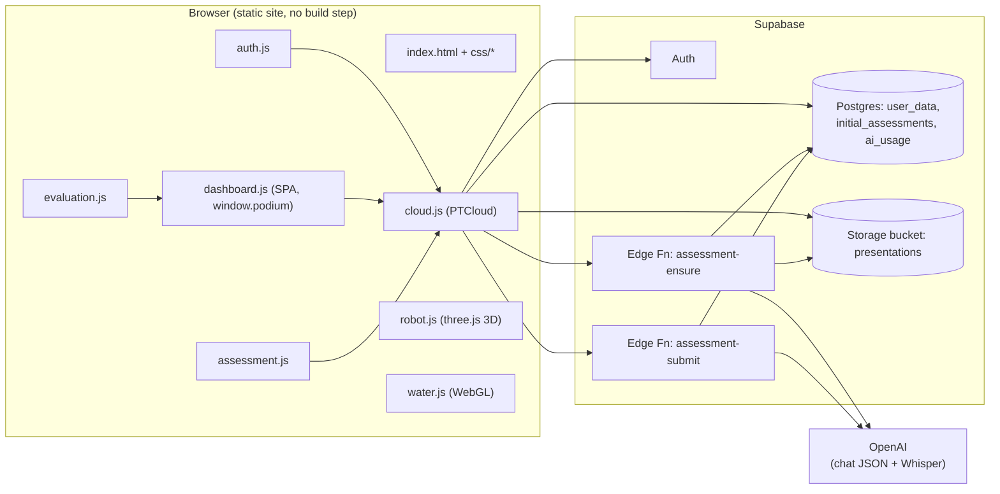

# PresentTrack: System Documentation

> Generated from the source in `presenttrack-main.rar` (43 files, all CRC-verified on extraction).
> Everything below is taken from the code. Where something is my inference rather than something the code states, it is marked **(inferred)**.

---

## 1. What the system is

**PresentTrack** is a browser app for rehearsing presentations out loud. A user signs up, uploads a deck (PDF, Word or PowerPoint), runs a timed practice session, logs filler words, and gets a score with tips. The app tracks progress over time and includes a 3D robot companion that guides the user and answers questions.

Its tagline in the UI: *"Rehearse out loud. Walk in ready."*

A newer feature, the **Initial Presentation Assessment**, measures a new user's baseline speaking ability (pace, fillers, long pauses, duration) and classifies it as *Proficient*, *Developing* or *Needs improvement*. It exists in two forms:

| Form | Where it runs | How speech is analysed | Status |
|---|---|---|---|
| **Start Evaluation** (`js/evaluation.js`) | Browser only | Web Speech API gives words and timings. No audio is recorded or uploaded. | Active |
| **Initial Assessment** (`js/assessment.js` + Supabase Edge Functions) | Browser plus server | Audio is recorded, sent to OpenAI Whisper, and metrics are computed server-side. | Off by default (`PT_FEATURES.assessment = false`) |

---

## 2. Architecture at a glance



**Key design choices**

- **No framework, no bundler.** Plain HTML, CSS and vanilla JS loaded with `<script>` tags. Views are template-string functions that render into `#view`.
- **One global namespace.** `window.podium` is the app object. `window.PTCloud` is the Supabase layer. Other modules extend the app through `podium.ext`.
- **Two run modes.** With Supabase configured, accounts and data are real. Without it, the app runs in an in-memory demo mode where nothing is saved.
- **Secrets stay server-side.** The OpenAI key exists only as an Edge Function secret.
- **Shared analysis code.** The scoring and metrics modules in `supabase/functions/_shared/` are environment-neutral JS. The browser imports them for the evaluation, and the Edge Functions use them for the assessment, so both use the same rules.

---

## 3. Repository layout

```
presenttrack-main/
├── index.html                  Single page: auth screen, app shell, landing, robot mount points
├── css/
│   ├── base.css                Tokens, reset, light/dark theme
│   ├── hero.css                Left-hand marketing panel on the auth screen
│   ├── auth.css                Login / register forms
│   ├── tour-demo.css           The looping "how it works" demo
│   ├── app-shell.css           Sidebar, top bar, layout
│   ├── landing.css             Welcome page after sign-in
│   ├── clay.css                Card / "clay" component styling
│   ├── dashboard.css           Dashboard, tables, charts, practice UI
│   ├── tour-guide.css          Guided-tour overlay and spotlight
│   └── assessment.css          Assessment and evaluation pages
├── js/
│   ├── config.js               Supabase URL + publishable key, feature flags
│   ├── cloud.js                PTCloud: auth, save, storage, edge-function calls
│   ├── auth.js                 Login/register UI, validation, password meter
│   ├── water.js                WebGL ripple background (no libraries)
│   ├── hero-tour-demo.js       Scripted 20-second product demo on the auth screen
│   ├── dashboard.js            The SPA: state, views, practice, tour, navigation (~89 KB)
│   ├── assessment.js           Initial Presentation Assessment UI (server-backed)
│   ├── evaluation.js           Start Evaluation (browser speech recognition)
│   └── robot.js                3D robot companion, voice in/out, Q&A
├── assets/models/
│   ├── robot.glb               3D robot model
│   └── robot-glb.js            Same model as base64 (generated, do not edit by hand)
├── tools/embed_glb.py          Regenerates robot-glb.js from robot.glb
├── sql/schema.sql              Original schema: user_data table + RLS
└── supabase/
    ├── README.md               Backend deploy + API + metric definitions
    ├── migrations/20261028_initial_assessment.sql
    ├── functions/
    │   ├── assessment-ensure/index.ts      Generates / returns the assessment deck
    │   ├── assessment-submit/index.ts      Transcribes audio, scores, saves results
    │   └── _shared/
    │       ├── criteria.js     Every threshold in one place
    │       ├── metrics.js      WPM, fillers, long pauses from word timings
    │       ├── quality.js      "Is this recording usable?" gate
    │       ├── classify.js     Points per dimension + final class
    │       ├── feedback.js     Rule-based feedback + validation of AI feedback
    │       ├── prompts.js      Topics, JSON schemas, prompt builders
    │       ├── deck.js         Validates AI deck JSON, builds the .pptx (pptxgenjs)
    │       └── edge.ts         Deno helpers: auth, CORS, OpenAI fetch, rate limiting
    └── tests/                  node:test suites + fixtures
```

---

## 4. Frontend

### 4.1 Script load order (`index.html`)

1. `config.js`: sets `window.PT_SUPABASE` and `window.PT_FEATURES`
2. `supabase-js@2.45.4` (CDN)
3. `cloud.js`: creates `window.PTCloud`
4. `auth.js`, `water.js`, `hero-tour-demo.js`
5. `dashboard.js`: creates `window.podium`
6. `assessment.js`, `evaluation.js`: extend `podium` through `podium.ext`
7. `three@0.128.0` and `GLTFLoader` (CDN), `robot-glb.js`, `robot.js`

Order matters. `assessment.js` and `evaluation.js` return early if `podium.ext` is missing, and `robot.js` returns early if `THREE.GLTFLoader` is missing, so the robot is optional.

### 4.2 Screens and views

**Before sign-in:** a split screen with the marketing panel and animated 20-second tour on the left, and Log in / Register on the right (theme toggle included).

**After sign-in:** a welcome/landing section, then the app shell with a sidebar, top bar (search, notifications bell, profile menu) and `#view`.

Sidebar navigation (`NAV` in `dashboard.js`):

| Group | Items |
|---|---|
| MAIN | Dashboard, My Presentations, Performance, Progress, Practice History |
| SYSTEM | Notifications, Settings |

Views registered in the `V` map (`dashboard.js`) and added by other modules:

| Key | View |
|---|---|
| `dash` | Dashboard: next presentation, readiness, performance cards, progress chart, AI coach panel, quick actions |
| `decks`, `create`, `up` | My Presentations: upload, rename, delete, preview |
| `pdet` | Presentation detail and checklist |
| `ready` | Presentation readiness ring |
| `prac`, `weak` | Practice (and weak-point practice) |
| `rec` | Upload a recording for analysis |
| `rep`, `rdet` | Reports list and single-session report |
| `perf` | Performance overview, first vs latest attempt |
| `prog` | Progress charts (metric selector: WPM, Filler Words, Long Pauses, Duration, Performance Score) |
| `hist` | Practice history |
| `coach` | AI Presentation Coach analysis |
| `goals` | Goals |
| `note` | Notifications |
| `set` | Settings (profile, picture, preferences) |
| `eval`, `evres` | Start Evaluation, evaluation results (`evaluation.js`) |
| `assess`, `assres` | Initial Assessment, assessment results (`assessment.js`) |

### 4.3 Client state

All app state lives in one object `S` inside `dashboard.js`:

```js
S = { u:{name,email,pic}, view, arg, loading, booted, flash, warnOff,
      pres:[], ses:[], notes:[], goals:[], nid:20, ... }
```

`podium.snapshot()` returns the part that is persisted:

```js
{ pres, ses, notes, goals, nid, ev }
```

| Field | Meaning |
|---|---|
| `pres` | Presentations: `id, t (title), short, file{name,size}, path, created, date, time, target (sec), ready (%), ppt, sp, final, left, preview…` |
| `ses` | Practice sessions: `id, deck, d (date), dur, wpm, fill, pau, score, tg (target sec)`, plus `assess:true` for the assessment |
| `notes` | Notifications (`r` = read flag) |
| `goals` | Goals with `%` progress |
| `nid` | Next numeric id counter |
| `ev` | Start Evaluation result (`ev.done` marks completion) |

### 4.4 Persistence (`cloud.js`)

- If `config.js` has a URL and key **and** the Supabase SDK loaded, `PTCloud.enabled = true`. Otherwise the app stays in demo mode.
- **Auto-save:** every 4 seconds, and when the tab is hidden, `PTCloud.save(snapshot)` upserts into `user_data`. It skips the write if the snapshot is unchanged.
- **`saveNow`** is used for deletions so the user sees whether the write really succeeded.
- **Files** go to the private storage bucket `presentations`, under `<user_id>/uploads/<id>-<filename>`.
- **Password reset:** the recovery link returns to the app, which prompts for a new password (min. 8 characters).
- **Social login** buttons (Google/Facebook) are hidden whenever cloud mode is on; they are demo-only.

### 4.5 Authentication (`auth.js`)

- Email + password via Supabase Auth, with friendly error messages.
- Register rules: name ≥ 2 characters, valid email, password ≥ 8 characters with strength ≥ 3 of 4 (length, capital, digit, symbol), and a Terms checkbox.
- If Supabase "Confirm email" is on, sign-up shows "check your email" and returns to the login tab.
- In demo mode, accounts live in an in-memory object and are lost on reload.

### 4.6 Practice session (`dashboard.js`, `B.prac`)

1. Pick a presentation and a target duration (1–240 min; quick chips for 3/5/10/15/20).
2. **Start / Pause / Resume / Finish / Reset**. The timer ticks every 200 ms. The ring turns red and shows "+m:ss over" past the target.
3. The user **taps filler-word chips** and pause markers while speaking. These are manual counts.
4. **Finish** needs at least 5 seconds. It saves a session, adds +2 to the presentation's readiness (capped at 100), creates a notification, and shows a score with tips.
5. The slide viewer shows the uploaded file during practice (PDF via pdf.js, PPTX via JSZip, DOCX via mammoth), with fullscreen and a fallback for browsers without the Fullscreen API.

**Practice score formula** (`scoreOf`), clamped to 40–99:

```
score = 100
      − min(30, |duration − target| / target × 50)
      − min(25, fillers × 1.2)
      − min(20, |wpm − 145| / 2)
      − min(10, longPauses × 2)
```

> **Note:** pace is no longer measured in live practice. `wpm` is stored as the constant `REFWPM = 145` (the code comment says so), so the pace term is always 0 and filler/pause counts come from manual taps.

### 4.7 Start Evaluation (`evaluation.js`)

For new accounts that must be evaluated before uploading or practising (`S.evalRequired`; other pages show an "EVALUATION REQUIRED" gate).

1. The user is given one of four random topics and talks for about 2–3 minutes (hard limits: min 20 s, max 300 s).
2. The browser's `SpeechRecognition` / `webkitSpeechRecognition` produces words with timings. Microphone permission is requested first. **No audio is recorded or uploaded.**
3. The shared modules (`metrics.js`, `quality.js`, `classify.js`, `feedback.js`, `criteria.js`) are loaded with a dynamic `import()` from `supabase/functions/_shared/` and produce WPM, fillers, long pauses, a quality check and a classification.
4. The result is saved in `user_data.data.ev`, so it is persistent and never asked twice. A retake is allowed.

**(inferred)** Because it uses `import()` of ES modules by relative path, this flow likely needs the site served over HTTP rather than opened by double-click from `file://`. The robot model is embedded as base64 specifically so it does work from `file://`.

### 4.8 Initial Assessment (`assessment.js`, feature-flagged)

Only active when `window.PT_FEATURES.assessment === true`. It talks to the Edge Functions through `PTCloud`.

1. `podium.assessInit()` runs after sign-in and calls `assessment-ensure`.
2. The server generates a short AI-written practice deck (5–7 slides, plus speaker guidelines) and stores it as a `.pptx`. The user presents it and records audio with `MediaRecorder` (prefers `audio/webm;codecs=opus`, then webm, mp4, ogg).
3. Audio is posted to `assessment-submit` and results appear in the dashboard banner, a results page, and as an "Initial Assessment" session in the history.

Assessment status values: `generating → ready → in_progress → completed`, or `failed`.

### 4.9 Robot companion (`robot.js`)

- A GLB robot rendered with three.js in the lower-right corner. Its eyes follow the cursor and it plays animations (idle, wave, listening, thinking, talking, celebrate).
- **Speaks** with `speechSynthesis` (voice can be turned off; a caption strip shows instead). **Listens** with `SpeechRecognition`.
- **Navigates by voice or text**: `podium.command()` matches phrases to pages ("go to practice", "my presentations", …) and reads a page guide.
- **Guided tour:** an automatic video-style tour for new users, replayable from Help.
- **Q&A:** `ask()` first tries navigation commands, then the host-provided `claude.use('sample')` model with the app's context (`podium.ctx()`: user, presentations, sessions), and falls back to local rule-based answers (pace, fillers, nerves, openings) when no model is available or rate limits hit.
- It can be minimised to a small button. If WebGL or three.js fail, it disables itself silently.

### 4.10 External browser dependencies

| Library | Version | Used for | Loaded |
|---|---|---|---|
| supabase-js | 2.45.4 | Auth, DB, storage, functions | `index.html` (jsDelivr) |
| three.js + GLTFLoader | 0.128.0 | Robot | `index.html` (jsDelivr) |
| pdf.js | 3.11.174 | PDF slide viewer | on demand (cdnjs) |
| JSZip | 3.10.1 | PPTX slide extraction | on demand (cdnjs) |
| mammoth | 1.6.0 | DOCX rendering | on demand (cdnjs) |
| jsPDF | 2.5.1 | PDF generation | on demand (cdnjs) |
| Google Fonts | Sora, DM Sans | Typography | `index.html` |

---

## 5. Backend (Supabase)

### 5.1 Database

**`public.user_data`** (from `sql/schema.sql`, extended by the migration)

| Column | Type | Notes |
|---|---|---|
| `user_id` | uuid PK | → `auth.users(id)`, cascade delete |
| `onboarded` | boolean | default false |
| `data` | jsonb | the app snapshot (§4.3) |
| `updated_at` | timestamptz | |
| `created_at` | timestamptz | added by migration |
| `initial_assessment_completed` | boolean | not null, default false |
| `initial_assessment_presentation_id` | uuid null | |
| `initial_assessment_completed_at` | timestamptz null | |

RLS is on. Four policies (select / insert / update / delete) restrict every operation to `auth.uid() = user_id`.

**`public.initial_assessments`**: one row per user: `status`, `title`, `slides` (visible content only), `guidelines` (kept separate), `file_path`, `file_name`, `results`, `classification`, `quality`, `error`, `gen_attempts`, `submit_attempts`, timestamps. RLS lets a user read their own row.

**`public.ai_usage`**: records per-user, per-kind calls for rate limiting, indexed on `(user_id, kind, created_at)`.

**Functions / triggers in the migration**

- `handle_new_user_data()` + trigger `on_auth_user_created_user_data`: creates a `user_data` row when a user signs up.
- `protect_assessment_fields()` + trigger `protect_assessment_fields`: protects assessment columns from client tampering.
- `begin_assessment_generation(p_user)`: decides whether to generate, wait or reuse.
- `complete_initial_assessment(...)`: marks the assessment complete.

**Backfill:** the first time the migration runs, **all existing accounts are marked as already assessed**, so only new sign-ups are required to do the assessment. The migration checks whether the flag column exists, so re-running it will not flip users who signed up later. It is idempotent.

### 5.2 Storage

Private bucket **`presentations`**. Policies allow select / insert / update / delete only when the first folder in the path equals the user's id. Insert/update/delete are further blocked on the `assessment` sub-folder, so users cannot tamper with the generated assessment file.

### 5.3 Edge Functions (Deno)

Both require `Authorization: Bearer <user JWT>`; identity comes only from the JWT (`verify_jwt` stays on and the code also verifies it).

**`assessment-ensure`**: POST JSON `{ action }`

| Action | Behaviour |
|---|---|
| `ensure` | Return current state; generate the assessment deck if required and absent |
| `start` | Move `ready → in_progress` |
| `status` | Read-only status |
| `remove` | Delete the generated deck, only after completion (results and the completed flag remain) |

Generation: picks a topic, asks OpenAI (chat, structured JSON) for 5–7 slides with 2–4 bullets each plus guidelines, validates it with `validateDeckContent`, builds the `.pptx` with `pptxgenjs@3.12.0`, and stores it. Limit: **5 generations per hour per user**. Returns `{required, assessment, userState}`; failure is `502 {error:'generation_failed', retryable:true}`.

**`assessment-submit`**: POST multipart (`audio`, `duration_sec`, optional `presentation_id`)

1. Validate: audio ≤ **10 MB**, `audio/*` only, duration **20–900 s**.
2. Rate limit: **6 transcriptions per hour per user**.
3. Transcribe with OpenAI **`whisper-1`** (`verbose_json`, word timings).
4. `computeMetrics` → `assessQuality` → `classify`, then feedback (AI-generated and validated, with rule-based fallback via `ruleBasedFeedback`).
5. Store results (transcript capped at 20,000 characters, 2,000 words kept).

Responses: `{ok:true, results}`; `422 unusable_recording` (nothing is completed, user can retry); `502 transcription_failed`; `409` if already completed with good quality (a completed result with quality `low` may be retaken); `413` for oversize; `429` rate-limited.

### 5.4 Secrets and environment

| Name | Where set | Purpose |
|---|---|---|
| `OPENAI_API_KEY` | `supabase secrets set` | Chat + Whisper |
| `OPENAI_MODEL` | `supabase secrets set` | Chat model (README example: `gpt-4o-mini`) |
| `SUPABASE_URL`, `SUPABASE_ANON_KEY`, `SUPABASE_SERVICE_ROLE_KEY` | Injected automatically | Function runtime |

---

## 6. Assessment metrics and classification

All thresholds live in `supabase/functions/_shared/criteria.js` (`CRITERIA`, deep-frozen, version 1). Change numbers there only.

### 6.1 Metric definitions

- **Words:** every recognised token (punctuation stripped, lowercased). Fillers count as words.
- **Speaking duration:** `(last word end − first word start) − sum of gaps ≥ 2.0 s`. Shorter pauses count as speaking; leading/trailing silence is excluded.
- **`wpm`** = words ÷ (speakingDuration ÷ 60). **`overallWpm`** = words ÷ (total recording seconds ÷ 60).
- **Fillers and long pauses per minute** use the span from first-word start to last-word end.
- **Fillers:** `um, umm, uhm, uh, uhh, er, erm, ano`, and the phrase "you know". "like" is counted only by heuristic: not after pronouns/verbs such as *I, we, they, would, looks, feel(s), just, something, anything*, and not before *to*. Those are reported as possible fillers (`heuristic: true`). "you know" is skipped after *do, did, if, as, don't…*.

### 6.2 Scoring (each dimension 0–2, max 8)

| Dimension | 2 points | 1 point | 0 points |
|---|---|---|---|
| Pace (wpm) | 130–160 | 110–180 | outside |
| Fillers / min | ≤ 3 | ≤ 6 | > 6 |
| Long pauses (≥ 2 s) / min | ≤ 2 | ≤ 5 | > 5 |
| Duration | 120–180 s | 90–210 s | outside |

- **Proficient:** ≥ 7 of 8 **and** no dimension at 0
- **Developing:** ≥ 4
- **Needs improvement:** otherwise

Pace alone never decides the class.

### 6.3 Quality gate

- **Unusable** (never completes): fewer than 40 words, speech under 25% of the recording, or most segments marked no-speech (segment `no_speech_prob > 0.6`, more than 50% of segments).
- **Low:** mean recognition confidence (mean of `exp(avg_logprob)`) below 0.5. Completes with a warning and a retake is allowed.

### 6.4 What is not evaluated

Eye contact, gestures, confidence, body language, voice tone, content quality. Results are a baseline, not a definitive judgement.

---

## 7. Main user flows

### 7.1 New user (cloud mode)

```
Register → (confirm email if enabled) → Log in
  → podium.enter() → loads user_data row
  → PTCloud.assessmentDone? 
       no  → evalRequired = true → upload & practice are gated until
             Start Evaluation (or Initial Assessment, if flagged on) is done
       yes → normal app
  → landing page → guided robot tour (first time) → dashboard
```

### 7.2 Upload and practise

```
My Presentations → pick PDF/DOCX/PPTX + title
  → upload to storage (<uid>/uploads/…) → preview generated → saved in user_data
Practice → set target time → Start → tap fillers → Finish
  → session saved → score + tips → notification → readiness +2
Reports / Performance / Progress / Coach → read the saved sessions
```

### 7.3 Initial Assessment (server-backed)

```
assessment-ensure(ensure) → generate deck via OpenAI → .pptx in storage → status: ready
assessment-ensure(start)  → in_progress
User presents the deck and records audio (MediaRecorder)
assessment-submit → Whisper → metrics → quality → classify → feedback
  → usable: status completed, flag set, results shown
  → unusable: 422, nothing completed, user retries
```

---

## 8. Security model

- **Row Level Security** on all user tables. Each user can only read and write their own rows.
- **Storage policies** scope every object to `<user_id>/…`, and lock the `assessment` sub-folder against writes.
- **`config.js` contains a Supabase project URL and a publishable key** (`sb_publishable_…`). That key type is designed for browser use and is safe only because RLS is enabled. The file's own comment says never to put the secret/`service_role` key there. If the repo is made public, treat the project URL and key as visible. Rotate the key if you have any doubt.
- **The OpenAI key never reaches the browser.** It is only a function secret.
- **Rate limits** are enforced per user in the database (5 generations/h, 6 transcriptions/h).
- **Input hardening:** HTML escaping helper (`esc`) is used when rendering user text; server-side `stripControl` and length caps clean AI output; audio type, size and duration are validated.
- The assessment deck's `guidelines` are stored separately from the visible `slides`.

---

## 9. Setup and deployment

### Run the frontend

1. Edit `js/config.js`: set `PT_SUPABASE.url` and `anonKey` (leave both empty for demo mode).
2. Serve the folder over HTTP (for example `python3 -m http.server`) **(recommended, see §4.7)**.

### Backend (see `supabase/README.md`)

```bash
supabase link --project-ref <your-project-ref>
supabase db push        # or paste migrations/20261028_initial_assessment.sql into the SQL editor
supabase secrets set OPENAI_API_KEY=<your-openai-key> OPENAI_MODEL=gpt-4o-mini
supabase functions deploy assessment-ensure assessment-submit
```

Run `sql/schema.sql` once for the base `user_data` table if you are not using the migration on a fresh project. Then set `window.PT_FEATURES = { assessment: true }` in `config.js` **only after** the migration is run and both functions are deployed.

### Regenerate the embedded robot

```bash
python3 tools/embed_glb.py     # rewrites assets/models/robot-glb.js from robot.glb
```

### Tests

```bash
cd supabase
NODE_PATH=<dir with pptxgenjs@3.12.0> DECK_OUT_DIR=<out dir> node --test tests/*.test.js
```

Tests cover classification, deck building, feedback, metrics and quality. The deck test also runs `unzip -t`, python-pptx and LibreOffice PDF conversion when available (skipped otherwise). `_shared/*.js` is environment-neutral; `edge.ts` and the two `index.ts` files are Deno-only and are **not** covered by Node tests.

---

## 10. Known limitations and things worth knowing

1. **Live practice does not measure pace.** `wpm` is a fixed 145 in saved sessions, so Reports/Performance WPM for normal practice is a placeholder. Only assessment/evaluation sessions carry measured WPM.
2. **Filler and pause counts in practice are manual taps**, not detected.
3. **Whisper smooths disfluencies**, so server-side filler counts are estimates and may run low. The prompt asks it to keep them, which helps but does not guarantee it. Browser speech recognition used by Start Evaluation has similar limits.
4. **Uploaded files for the slide viewer are held in memory** (`FILES`), so after a reload the viewer depends on re-downloading from storage in cloud mode.
5. **Demo mode is non-persistent**: in-memory accounts and data disappear on reload.
6. **Social login is a stub** and is hidden in cloud mode.
7. **The assessment feature is off by default** and must be enabled deliberately (§9).
8. **Edge request time limits apply**: generation can take up to roughly 2 minutes in the worst case with one retry.
9. **Browser support:** the evaluation, voice robot and recording features depend on `SpeechRecognition`, `getUserMedia` and `MediaRecorder`; unsupported browsers show a friendly error and the rest of the app still works.
10. **CDN dependence:** supabase-js and three.js load from jsDelivr at page load, and the viewer libraries from cdnjs on demand, so offline use is limited.

---

## 11. Quick reference

| I want to… | Look in |
|---|---|
| Change scoring thresholds for the assessment | `supabase/functions/_shared/criteria.js` |
| Change the practice score formula | `js/dashboard.js` → `scoreOf` |
| Add or edit a page/view | `js/dashboard.js` → `V`, `B`, `NAV`, `PARENT` |
| Change what is saved per user | `podium.snapshot` in `js/dashboard.js` + `user_data.data` |
| Change AI deck or feedback prompts | `supabase/functions/_shared/prompts.js` |
| Change rate limits | `MAX_GENERATIONS_PER_HOUR` / `MAX_TRANSCRIPTIONS_PER_HOUR` in the two `index.ts` files |
| Change evaluation topics | `TOPICS` in `js/evaluation.js` |
| Turn the assessment on or off | `PT_FEATURES.assessment` in `js/config.js` |
| Update the robot model | edit `robot.glb`, run `tools/embed_glb.py` |
