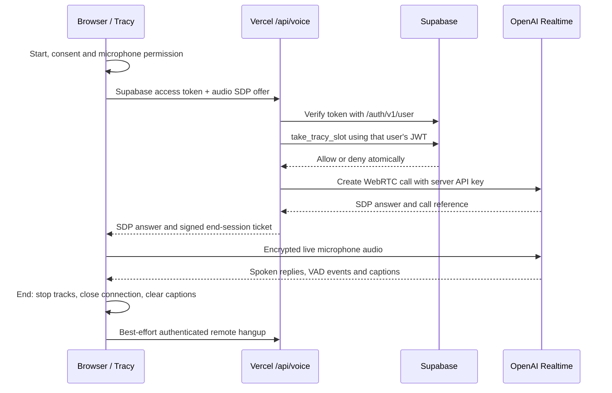

# Tracy: PresentTrack voice AI

Tracy uses your existing 3D robot, with a compact voice panel in place of the text chatbox. Open the robot, choose **Start conversation**, grant microphone access, and speak. Automatic turn detection handles pauses between questions. **Interrupt**, **Mute mic**, **End conversation**, voice selection, and optional current-turn captions are available. The speaker control is separate from microphone mute.

## Cause of the old error

The original local configuration had an OpenAI key and Supabase URL, but `SUPABASE_ANON_KEY` and `SUPABASE_SERVICE_ROLE_KEY` were empty. The old endpoint required both and failed before sending the prompt. A live check also returned `404 / PGRST202` for the old `take_robot_chat_slot` function. These were concrete setup problems, not evidence that OpenAI was down.

The public key was filled locally from your existing `js/config.js`. The backend now uses the signed-in user's JWT for the new quota function; **Tracy no longer needs a service-role key**. You confirmed applying `supabase/migrations/20261106_tracy_voice.sql`. A subsequent live check returned `401 / 42501` for an anonymous call to `take_tracy_slot`, confirming the function exists and anonymous execution is denied. Missing and deliberately invalid tokens also return 401 through the backend.

Read-only OpenAI model lookups succeeded for the configured text, realtime and caption models. Model access is not proof of available billing credits or successful audio generation. Local environment settings do not configure your deployed Vercel project automatically.

## Architecture



Vercel handles short HTTP requests for setup and shutdown. OpenAI hosts the live connection and speech-to-speech generation, avoiding an always-running model server in Vercel. Conversation context stays in the active provider session. Caption transcription is for accessibility; it is not the input pipeline for responses. This follows the [official WebRTC unified interface](https://developers.openai.com/api/docs/guides/voice-webrtc).

The server supplies Tracy's presentation-coach instructions, automatic VAD with interruption, and a built-in synthetic voice (Marin, Cedar or Coral). The model is instructed to speak concise, conversational English, Filipino or Taglish, follow the student's language, avoid invented scores and never claim unconfirmed application actions. Language accuracy and naturalness require listening tests. No real person's voice is cloned.

The existing GLB contains `Mouth`, `Eyes`, `Ears` and hand controls. Those controls and the animation loop are retained. Speaking events drive the existing mouth movement; this is speaking feedback, not phoneme-accurate lip-sync. Guided-tour narration retains browser speech synthesis. Starting voice pauses the tour; using Guide me ends the voice conversation first.

## VoiceStudio review

The reviewed repository is a local voice-production platform with speech generation, profiles, cloning, dictation, transcription, dubbing and audiobook features. Its [engine documentation](https://github.com/debpalash/VoiceStudio/blob/main/docs/engines/README.md) lists OmniVoice, KittenTTS, MLX-Audio and other selectable engines. Hardware support varies: CPU, CUDA and Apple Silicon paths exist.

Its [Python configuration](https://github.com/debpalash/VoiceStudio/blob/main/pyproject.toml) requires Python 3.11+ and includes PyTorch, Transformers, FastAPI/Uvicorn, WhisperX/faster-whisper and audio-processing dependencies. Its [JavaScript package](https://github.com/debpalash/VoiceStudio/blob/main/package.json) uses Bun and an Electron/web workspace. These are substantial runtime services, not a browser-only TTS library.

Source confirms [streaming TTS](https://github.com/debpalash/VoiceStudio/blob/main/backend/api/routers/tts_stream.py), [streaming ASR](https://github.com/debpalash/VoiceStudio/blob/main/docs/speech-platform.md) and a [phone-call agent API](https://github.com/debpalash/VoiceStudio/blob/main/backend/api/routers/calls.py). These are not a drop-in PresentTrack browser conversation feature. The [license](https://github.com/debpalash/VoiceStudio/blob/main/LICENSE) is AGPL-3.0; the Python manifest mentions commercial licensing and separately licensed engines. No VoiceStudio code, models or voices were copied into this project.

**Deployment conclusion (inference):** its local model pipeline belongs on a dedicated CPU/GPU server with persistent model storage and WebSocket support. It is not a practical direct transplant into this application's Vercel Functions. See [function limits](https://vercel.com/docs/functions/limitations) and [WebSocket guidance](https://vercel.com/kb/guide/do-vercel-serverless-functions-support-websocket-connections).

If you later self-host VoiceStudio, use an authenticated HTTPS/WebSocket backend on that separate server, retain Supabase verification, and stream TTS/ASR through a protected service. That requires a deployment, model/hardware selection and license review. The implemented OpenAI alternative needs no separate model hosting; OpenAI audio usage is billable, and Vercel/Supabase plan limits also apply.

## Files

| Files | Change |
| --- | --- |
| `js/voice-session.js` | WebRTC lifecycle, microphone, VAD, replies, interruption, cleanup and bounded captions |
| `js/robot-voice.js`, `css/robot-voice.css`, `index.html` | Compact Tracy voice controls; text-entry panel removed |
| `js/robot.js` | Existing robot state integration; old hold-to-talk/text-chat path replaced |
| `api/voice.js`, `server/voice.mjs` | Authenticated setup and owner-bound remote hangup; signed call tickets and fixed initial session settings |
| `server/ai-access.mjs`, `server/chat.mjs` | Shared verified authentication and quotas; text endpoint retained but no longer used by the robot UI |
| `js/dashboard.js`, `js/assessment.js`, `js/evaluation.js` | Stop Tracy before navigation, tour, practice or evaluation capture; update obsolete robot instructions |
| `supabase/migrations/20261106_tracy_voice.sql` | Atomic authenticated quota function and usage metadata table; already applied per your confirmation |
| `tools/dev.mjs`, `vercel.json`, `.env.example`, `package.json` | Voice route, environment template and diagnostic command |
| `tools/diagnose-ai.mjs`, `tests/*voice*.test.mjs` | Safe live diagnostics and automated voice tests |

The GLB and embedded `assets/models/robot-glb.js` are unchanged. No student records or presentation files are sent to AI automatically.

## Environment and local startup

Use Node.js 24. There are no additional npm runtime dependencies.

```powershell
npm install
npm run dev
```

Open **http://localhost:3000**, sign in, open Tracy, and choose **Start conversation**. Opening `index.html` directly or using a static-only server cannot run the backend. Production microphone access requires HTTPS.

Required `.env.local` settings:

```dotenv
OPENAI_API_KEY=your-private-openai-key
SUPABASE_URL=https://your-existing-project.supabase.co
SUPABASE_ANON_KEY=your-existing-publishable-or-anon-key
OPENAI_REALTIME_MODEL=gpt-realtime-2.1
OPENAI_TRANSCRIBE_MODEL=gpt-4o-mini-transcribe
# Only used by the retained /api/chat endpoint:
OPENAI_MODEL=gpt-4o-mini
```

Your local secret was retained without displaying it. The public Supabase key was copied from your existing frontend configuration. No additional API key or migration is required beyond the Tracy migration you applied. An existing `SUPABASE_SERVICE_ROLE_KEY` entry can remain unused; never put it in browser files. Restart the local server after editing environment variables.

## Security, limits and privacy

* Setup and hangup verify bearer tokens with Supabase's `/auth/v1/user`. Demo users, anonymous accounts and invalid tokens cannot start AI sessions. The backend never trusts a user ID in request JSON.
* `take_tracy_slot('voice')` uses `auth.uid()`, accepts only recognized usage kinds, and serializes count/insert under a per-user transaction advisory lock. It permits **2 starts/minute, 6/hour and 12/day**. Failed provider attempts still consume a start. The text endpoint retains 5/minute, 30/hour and 100/day limits. Quota failures fail closed.
* The server rejects invalid/large SDP, video offers, unsupported voices and client-supplied instructions/model overrides. Responses never include the OpenAI key or Supabase server credentials. Signed call tickets are tied to the authenticated user.
* Initial settings limit responses to **600 output tokens** and conversation context to **6,000 tokens**, with truncation. The app ends after **10 minutes**, **20 completed replies**, or **90 seconds of inactivity**. Older context can be truncated.
* **Limit boundary:** WebRTC clients can send provider session-update events. UI duration/turn limits and initial settings are not a tamper-proof spending cap. Database start quotas are enforced server-side; strict live-session cost enforcement would require a trusted sideband service. Use provider project usage controls. OpenAI also documents a provider session-duration maximum in its [Realtime guide](https://developers.openai.com/api/docs/guides/realtime-conversations).
* Tracks are disabled while connecting or microphone-muted, and stopped completely on End, Close, sign-out, account switch, hidden tab, page exit, minimize or error. Mute can leave the device allocated until End; the UI distinguishes muted from off. Late permission grants are stopped after cancellation.
* PresentTrack saves no recordings or captions, only usage metadata. OpenAI processes live audio and context under its own retention policies. End clears browser captions and disconnects audio; remote hangup is best-effort during network loss. Synthetic voice and audio sharing are disclosed before Start.

## Verification

For a deployed-site connection error, run:

```powershell
node tools/check-deployment.mjs https://presenttrack-nu.vercel.app
```

Both invalid/missing-token probes should return 401. A `setup_required` response means at least one of `OPENAI_API_KEY`, `SUPABASE_URL`, or `SUPABASE_ANON_KEY` is missing from that deployment. Copy those values privately from `.env.local` into the existing Vercel project's Production environment, then redeploy. Values added only to Preview or Development do not configure the production URL. A passing probe confirms authentication rejection, not a complete signed-in voice conversation.

```powershell
npm test
npm run test:assessment
npm run build
npm run diagnose:ai
git check-ignore .env.local
```

Diagnostics read local secrets but print only presence, HTTP statuses and sanitized codes. They check model access, anonymous RPC rejection and missing/invalid token rejection without microphone audio or a valid student token. A healthy anonymous quota probe is **401 / 42501**, not 200. The old `take_robot_chat_slot` is no longer required.

Tests cover authentication, user-token quota calls, setup failures, limits/failures, ticket ownership, malformed inputs, voice lifecycle, repeated turns on one connection, duplicate Start, permission denial, late grants, mute, barge-in, interruption, autoplay, disconnects, timeouts, account switches, page hiding and caption safety. Existing classification, metrics, quality and feedback tests pass. Voice tests simulate browser/provider APIs; they do not measure speech accuracy or voice quality.

Live checks completed: the quota function exists and denies anonymous execution; the backend rejects missing/invalid tokens; the selected OpenAI models are accessible. **Live authenticated quota exhaustion, WebRTC audio, billing allowance, deployment and browser rendering remain unverified by this environment.** No browser-control tool or signed-in student session is available to the agent.

Manual checks on your signed-in localhost and deployed site:

1. Start and allow the mic. Ask “What is your name?” and confirm Tracy replies aloud.
2. Ask for a thesis introduction, then “Make that shorter.” Confirm continuity.
3. Speak over Tracy and test Interrupt. Confirm unheard audio stops and follow-ups work.
4. Mute/unmute, then End. Verify the browser microphone indicator stops after End.
5. Test denied permission, offline mode, hidden tab, minimize, sign-out and refresh. Confirm cleanup and Retry.
6. Test speakers/headphones, all voices, English/Filipino/Taglish, captions, mobile portrait/landscape and Enable audio when autoplay is blocked. Check existing eye/idle animation and mouth feedback.
7. Start/end three calls within one minute using a test account; the third should return 429. A second account should have an independent allowance. Hour/day tests belong on test accounts. Optional database verification without voice charges is in `supabase/tests/tracy-quota.sql`; it is not a migration.
8. Smoke-test tours, uploads, practice, evaluation and reports. Starting evaluation must stop Tracy. Voice cannot start on an evaluation/assessment page.

## GitHub and Vercel

1. Add the environment settings above to the **existing Vercel project → Settings → Environment Variables** for the environments you use. Supabase Edge Function secrets and `.env.local` do not automatically transfer to Vercel.
2. Keep framework **Other**, Node **24.x**, build **`npm run build`**, output **`dist`**. Both routes are in `vercel.json`; no catch-all rewrite should intercept `/api/voice`.
3. Review `git diff` and `git status`. `.env.local` must remain ignored. The build copies only public assets and required evaluation modules.
4. Commit and push:

   ```powershell
   git add .env.example CHAT_SETUP.md TRACY_VOICE_SETUP.md package.json vercel.json index.html api/voice.js server/ai-access.mjs server/voice.mjs server/chat.mjs js/voice-session.js js/robot-voice.js js/robot.js js/dashboard.js js/evaluation.js js/assessment.js css/robot-voice.css tools/dev.mjs tools/diagnose-ai.mjs tests supabase/migrations/20261106_tracy_voice.sql supabase/tests/tracy-quota.sql
   git add -u js/robot-chat.js css/robot-chat.css
   git commit -m "Add Tracy realtime voice conversations"
   git push
   ```

   Use `git push -u origin HEAD` for a new branch. Follow your normal merge process for production.
5. Confirm the deployment becomes Ready and contains `/api/voice`. Sign in at its HTTPS URL and run the checklist. Redeploy after changing Vercel environment variables.

The agent did not push or deploy. No separate VoiceStudio hosting or additional voice-provider key is needed for this implementation.
